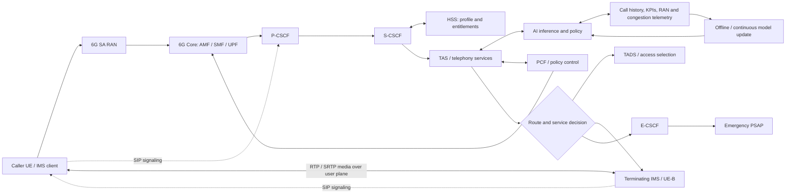
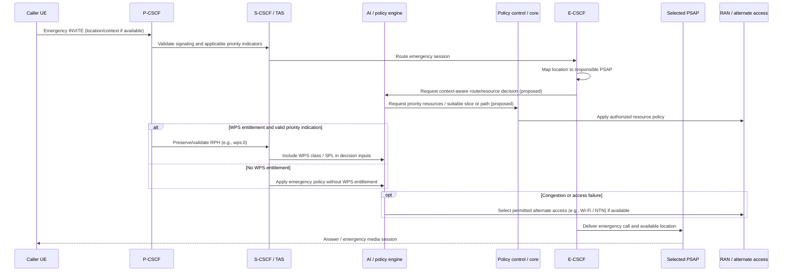
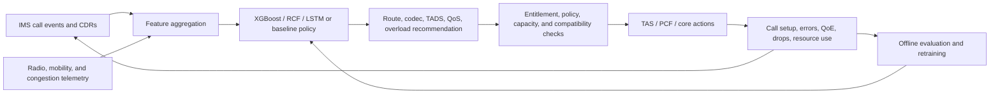

# Voice call In 6G (__*Work in progress*__)
6G voice is a design and research topic, not yet a standardized end-to-end system. IMS is the mature 3GPP multimedia-service baseline to consider, but its precise role and evolution in 6G remain subject to Release 21 standardization.

# 6G Standalone (SA) Voice Call: Conceptual Architecture & Design

This work-in-progress document explores a possible end-to-end design for voice over a future 6G Standalone (SA) system. The diagrams, protocol labels, and signaling flows below are proposals, not a technical specification; the standards status and design boundaries are clarified in the addendum.

---

## 0. Draft initial layout

```

+-------------------------------------------------------------+
|              IMS / Next-Gen Communication Engine            |  <-- Session Control, Data Channels, AI Services
+-------------------------------------------------------------+
|               AI / Intelligence & Data Fabric               |  <-- AI Models (Codecs), Network Agents (NWDAF+)
+-------------------------------------------------------------+
|          6G Core Network (6GC) / Service-Based              |  <-- AMF, SMF/UPF, Network Slicing
+-------------------------------------------------------------+
|  6G Radio Access (RAN)  |  Non-Terrestrial Networks (NTN)   |  <-- Terahertz, Satellite Packet Forwarders
+-------------------------------------------------------------+

```

## 1. Architectural Blueprint & Network Topography

This is a **conceptual design**, not a 3GPP architecture. It explores how a future 6G system might build on service-based core principles while supporting AI-enabled services and terrestrial/non-terrestrial access. The eventual 6G architecture, interfaces, and voice procedures remain to be standardized.

### 1.1 Structural Topology Block Diagram

```
+-------------------------------------------------------------------------------------------------+
|                                 IMS / NEXT-GEN INTERACTIVE FABRIC                               |
|   +--------------------------+   +--------------------------+   +---------------------------+   |
|   |   S-CSCF (SIP Server)    |   |   P-CSCF (Proxy Edge)    |   |  IMS-DC (Data Channel)    |   |
|   +--------------------------+   +--------------------------+   +---------------------------+   |
+-----------------------------------------------+-------------------------------------------------+
                                                | Rx / N5 / Sh / Nims
+-----------------------------------------------+-------------------------------------------------+
|                         6G SERVICE-BASED CORE NETWORK (6GC-SA)                                  |
|   +--------------------------+   +--------------------------+   +---------------------------+   |
|   |  AMF (Mobility/Signaling)|   |  SMF (Session Control)   |   | NEF / Ad-Func (AI Agent)  |   |
|   +--------------------------+   +--------------------------+   +---------------------------+   |
|                                               |                                                 |
|   +-------------------------------------------+---------------------------------------------+   |
|   |                    UPF (User Plane Function) + MoE (Mixture of Experts Engine)          |   |
|   +-------------------------------------------+---------------------------------------------+   |
+-----------------------------------------------+-------------------------------------------------+
                                                | N3 / N9 (User Plane)
+-----------------------------------------------+-------------------------------------------------+
|                                 NATIVE 6G RADIO ACCESS NETWORK                                  |
|       +---------------------------------------+---------------------------------------+         |
|       |     6G gNB (Sub-THz / FR3 Small Cell) |     LEO Satellite Packet Forwarder    |         |
|       +---------------------------------------+---------------------------------------+         |
+-----------------------------------------------+-------------------------------------------------+
                                                | Air Interface (Uu / Un-NTN)
+-----------------------------------------------+-------------------------------------------------+
|                                    USER EQUIPMENT (UE-6G)                                       |
|    +------------------------------------------+--------------------------------------------+    |
|    |  Semantic Transceiver / Neural Codec Core|  Local Autonomous Conversational AI Agent  |    |
|    +------------------------------------------+--------------------------------------------+    |
+-------------------------------------------------------------------------------------------------+
```

### 1.2 Key Architectural Evolution Highlights
*   **Semantic Layer Integration:** The user plane incorporates a semantic processing layer utilizing a
    **Mixture of Experts (MoE)** engine to compress voice streams into high-level intent/feature vectors.
*   **IMS Data Channel Evolution (IMS-DC):** Extends IMS capabilities to concurrently transmit bootstrap
    application scripts, real-time spatial texturizers, and AI agent translation context alongside the audio
    sync block.
*   **Unified NTN Plane:** Satellite linkages share an integrated user plane control loop directly with edge
    nodes, removing the distinct delay boundaries typical in legacy inter-working modes.

---

## 2. Protocol Stack Design

The 6G SA Control Plane and User Plane are optimized for minimal framing overhead and native handling of AI/Semantic traffic components.

### 2.1 User Plane Protocol Stack

```
   +-----------------------------+
   |   Neural App Voice / XR     |  <-- Semantic Tokens & Media Synchronization Strings
   +-----------------------------+
   |             IMS-DC          |  <-- Data Channel Layer / WebRTC Framing Protocol
   +-----------------------------+
   |             RTP             |  <-- Real-Time Transport Protocol (Optimized RFC 3550)
   +-----------------------------+
   |             UDP             |  <-- User Datagram Protocol
   +-----------------------------+
   |             IP              |  <-- IPv6 Layer with Segment Routing (SRv6) Headers
   +-----------------------------+
   |           6G-SDAP           |  <-- Service Data Adaptation Protocol (QoS mapping to AI-Slices)
   +-----------------------------+
   |           6G-PDCP           |  <-- Packet Data Convergence Protocol (ROHC with AI State Prediction)
   +-----------------------------+
   |            6G-RLC           |  <-- Radio Link Control
   +-----------------------------+
   |            6G-MAC           |  <-- Medium Access Control
   +-----------------------------+
   |            6G-PHY           |  <-- sub-THz / FR3 Radio Layer (Spatial-multiplexed waveforms)
   +-----------------------------+
```

### 2.2 Control Plane Innovations
The Control Plane simplifies session setup by introducing an explicit **AI-Intent Signaling Layer** embedded inside the NAS (Non-Access Stratum) container, facilitating pre-allocation of Edge Compute engines prior to SIP Session Initiation.

---

## 3. End-to-End Signaling Sequence (Vo6G SA Session Establishment) - Draft

The following sequence details an end-to-end call establishment between UE-A (initiating agent/human) and UE-B within a Standalone 6G topology.

```
 UE-A (6G)           6G gNB            6G AMF/SMF          IMS/P-CSCF          UE-B (6G)
   |                   |                    |                   |                  |
   |-- 1. NAS Intent ->|                    |                   |                  |
   |   (Voice Request) |-- 2. Service Req ->|                   |                  |
   |                   |   & Slice Assign   |                   |                  |
   |                   |<-- 3. PDU Session -|                   |                  |
   |                   |       Modification |                   |                  |
   |<-- 4. RRC Reconf -|                    |                   |                  |
   |   (QoS-20 Flow)   |                    |                   |                  |
   |                   |                    |                   |                  |
   |============ 5. SIP INVITE (SDP: Semantic, Neural Codec)  =>|                  |
   |                                        |                   |-- 6. SIP INVITE->|
   |                                        |                   |   (P-CSCF Alloc) |
   |                                        |                   |<-- 7. 180 Ring --|
   |<=========== 8. SIP 180 Ringing ============================|                  |
   |                                        |                   |<-- 9. 200 OK ----|
   |<=========== 10. SIP 200 OK (SDP Negotiated Matrix) ========|                  |
   |                                        |                   |                  |
   |============ 11. SIP ACK ==================================>|-- 12. SIP ACK -->|
   |                                        |                   |                  |
   |<======================== 13. NATIVE VOICE SESSION ===========================>|
   |             (Bi-directional Semantic Token / Real-Time Data Channel)          |
```

### 3.1 Signaling Flow Descriptions

1.  **NAS Intent Broadcast:** UE-A passes a highly compressed Non-Access Stratum (NAS) Intent message to the network containing pre-calculated network slice telemetry requests optimized for semantic communication profile sets.
2.  **Service Request & Resource Reservation:** The AMF handles authorization and prompts the SMF to spin up a specialized high-priority voice slice profile mapping directly to the active User Plane Function (UPF).
3.  **Dynamic QoS Allocation:** The 6G Core issues dedicated resource rules configuring the gNB scheduler loop with ultra-precise scheduling configurations (QoS Flow ID 20, optimized for low latency jitter boundaries).
4.  **SIP Session Handshake:** UE-A launches an extended SIP INVITE request through the established PDU tunnel to the P-CSCF. The Session Description Protocol (SDP) fields state negotiation vectors for custom generative audio parameters instead of fixed bandwidth numbers.
5.  **Session Acceptance & Synchronization:** The network routes the session downstream to UE-B, triggering verification handshakes. Upon confirmation, a 200 OK signal locks the target configuration arrays and releases conversational flow states over the active user-plane connection.

---

## 4. 3GPP Standardization Framework

The relevant 3GPP work spans service requirements (SA1), system architecture (SA2), multimedia and codecs (CT/SA4), security (SA3), and radio access (RAN). The existence of a related 5G specification or a research proposal does not make it a 6G requirement. Do not treat the earlier draft's labels, latency figures, or protocol extensions as 3GPP-defined 6G features.

Useful current anchors are **TR 22.870** for 6G use cases and service requirements, **TS 22.173** for the established multimedia telephony service, **TS 23.228** for the established IMS architecture, and the 3GPP **Release 21 timeline** for the 6G normative-work milestones. These references have different scope: TR 22.870 is a study report, while TS 22.173 and TS 23.228 describe existing service and IMS baselines, not a finished 6G voice specification.

---

## 5. Research Directions

Research is exploring AI-enabled voice coding, efficient voice over constrained NTN links, and more programmable RAN resource control. These are research directions and prototypes—not evidence that 6G will use a semantic-token voice format, put generative models in the UPF, or require an AI-controlled IMS. Results for one codec, channel, or simulation should not be generalized into an end-to-end 6G voice guarantee.

## 6G Voice: 3GPP Standardization Perspective

*Addendum (7 November 2026). This section supplements the draft above; it does not revise the preceding material.*

### What 3GPP has standardized so far

3GPP's Release 20 6G work includes SA1's study of use cases and service requirements, documented in [TR 22.870, *Study on 6G Use Cases and Service Requirements*](https://portal.3gpp.org/desktopmodules/Specifications/SpecificationDetails.aspx?specificationId=4374). A TR is a study report: it records study results and is not, by itself, a normative specification of an implementable 6G voice system. As of this addendum, 3GPP has not published a normative specification defining a distinct 6G voice-call architecture, call procedures, or 6G-specific voice protocol stack.

The established 3GPP reference for IP multimedia telephony is IMS: [TS 22.173](https://portal.3gpp.org/desktopmodules/Specifications/SpecificationDetails.aspx?specificationId=620) specifies multimedia telephony service requirements, and [TS 23.228](https://portal.3gpp.org/desktopmodules/Specifications/SpecificationDetails.aspx?specificationId=821) specifies the IMS architecture. These are useful baselines for discussing future voice service, but they do not, on their own, specify how a future 6G radio or core implements voice. A 6G IMS evolution or alternative would need to be established through approved 3GPP work and specifications, not inferred from a study report.

### Standardization path and voice topics

3GPP describes Release 20 as the 6G study phase and Release 21 as the start of normative 6G specification work. The [3GPP Release 21 timeline](https://www.3gpp.org/news-events/3gpp-news/rel21-timeline) gives the current stage milestones; these are program targets, not a guarantee that any particular voice feature will be standardized. SA1 develops service requirements; architecture, security, media, and radio specifications are developed by the relevant 3GPP groups as work items are approved.

For voice-call standardization, the questions to track include service requirements and call continuity; IMS/core and access architecture; media and codec negotiation; QoS and latency treatment; mobility and interworking; emergency and priority communications; and security, privacy, and interoperability. These are topics for standards work, not claims that a particular 6G solution or performance target has already been adopted.

### How to read the proposed architecture above

The architecture, signaling flow, and protocol labels in this document are design proposals, not an approved 3GPP 6G specification. In particular, names such as “NAS Intent,” “QoS Flow ID 20” as a standardized voice profile, “semantic/neural codec” SDP extensions, and a “MoE” in the UPF should not be read as 3GPP-defined 6G procedures or interfaces. Treat them as concepts requiring formal specification and interoperability work unless and until the relevant 3GPP specifications define them.

## IMS, 6G Core, and SA RAN: Design Responsibilities

A useful way to design a 6G voice call is to keep **service control**, **packet-session policy**, and **radio delivery** distinct, then define their interfaces and failure handling. IMS is not the radio scheduler, and the 6G Core is not the SIP call server. A service can use IMS over an IP connection delivered by the mobile core and radio access.

| Domain | Role in a voice call | Design boundary |
|---|---|---|
| **IMS / service layer** | Authenticates and registers the subscriber for IMS services; routes SIP sessions; applies telephony service logic; negotiates compatible media; and supports supplementary services and interworking with other IMS networks. | Owns call/session semantics, not radio scheduling or user-packet forwarding. Any IMS evolution for 6G, including AI-assisted features, needs defined service behavior, security, and interoperable signaling. |
| **6G Core** | Provides access and mobility management, establishes and manages the IP session, applies subscription and operator policy, selects user-plane connectivity, and coordinates QoS treatment and service exposure with the access network. It can support charging, lawful/regulatory functions, and continuity according to the eventual system design. | Carries and governs connectivity for IMS and media; it does not replace SIP service control. Exact 6G functions, interfaces, QoS identifiers, and IMS-to-core policy procedures are not yet specified. |
| **6G SA RAN** | Connects directly to the 6G core (without relying on an LTE anchor), establishes radio bearers, maps authorized QoS treatment to radio resources, schedules uplink/downlink packets, adapts to channel conditions, and handles radio mobility and link recovery. | Delivers packets under radio constraints; it does not decide who to call or provide telephony service logic. “SA” describes the core connection model, not a promise of zero latency or a dedicated voice slice. |
| **UE and media endpoints** | Run the IMS client, negotiate and encode/decode media, protect media as applicable, and report radio/media conditions through supported mechanisms. | Codec/model capability and energy use are endpoint constraints; both ends need interoperable media options and a fallback path. |

### Illustrative call lifecycle (not a 6G procedure)

1. The UE obtains access and an IP session through the SA network. The core applies subscriber and operator policy; the RAN provides the radio connection.
2. The UE registers with IMS and sends a SIP session request over IP. IMS performs service routing and negotiates the mutually supported media parameters with the far end.
3. If the service needs dedicated or differentiated packet treatment, IMS/service policy can request it through the core's policy mechanisms. The core authorizes and provisions the packet treatment, and the RAN maps it to available radio resources. Exact 6G procedures remain to be defined.
4. Voice media travels between endpoints through the user plane; IMS remains responsible for session control. Mobility, congestion, loss, or a change of access may trigger policy updates, media adaptation, or session continuity behavior.
5. On release, IMS clears the session and the network releases resources when no longer needed.

SIP signaling and the media path are separate logical functions even when they share IP connectivity. IMS Data Channels, where supported, are an optional rich-communication capability and are not the voice codec or a mandatory voice-media layer. Likewise, a PDU/IP session or a slice is not itself a voice service: the service, policy, QoS handling, and end-to-end media behavior must work together.

### What 6G SA RAN changes for the voice designer

SA removes dependence on an LTE anchor for the access-to-core path; it does **not** make voice intrinsically reliable or remove radio effects. The RAN still faces fading, interference, blockage, handover gaps, uplink power limits, and competition for spectrum. Those effects directly shape conversational quality through packet loss, jitter, delay, and interruption.

For a voice-service design, the key RAN-to-core questions are:

- **QoS mapping and admission:** How does authorized service policy become radio scheduling priority and an appropriate bearer/flow treatment? What happens when radio resources are scarce—admission control, degradation, or pre-emption—and how are those decisions coordinated end to end?
- **Mobility and continuity:** How are media packets protected through handover, beam changes, cell-edge operation, and terrestrial/NTN transitions? Call continuity must be tested across access changes, not inferred from a fast scheduler.
- **Coverage and power:** Voice quality and availability at the cell edge, indoors, and on uplink-limited devices matter as much as peak data rate. High-frequency or very wideband radio is not a prerequisite for good voice.
- **Scheduling and resilience:** Low-latency scheduling can help, but queueing in the UE, RAN, transport, core, and far-end path all contribute. A service target needs an end-to-end budget and measurable recovery behavior, not a single radio latency number.
- **AI-assisted control:** RAN automation/xApps may help optimize resources against an SLA, but control-loop delay, data quality, policy constraints, stability, explainability, and safe fallback matter. AI should augment—not replace—deterministic service policy and radio safety controls.
- **NTN:** Satellite access extends reach but has distinct propagation delay, Doppler, and intermittent-link constraints. Codec efficiency and adaptation help with limited capacity; they cannot eliminate propagation delay. Interactive voice must be evaluated separately from delay-tolerant messaging.

### Current research-informed design view (7 November 2026)

The most defensible near-term design is **evolutionary and service-led**: preserve interoperable IMS telephony and media negotiation as the baseline, and let a future 6G access/core improve coverage, continuity, policy coordination, and automation without assuming a new “native 6G voice” protocol. Research is valuable for selecting candidate enhancements, but it does not establish a 3GPP architecture or deployment requirement.

For designers, prioritize conversational quality and operability—mouth-to-ear delay, jitter, loss concealment, intelligibility, call setup success, handover interruption, emergency calling, security, and interoperability—over headline radio throughput or an isolated latency result. AI-enhanced codecs and translation may be optional negotiated features; the endpoints need a conventional interoperable fallback. Any learned model should be assessed for compute and battery cost, privacy, security, robustness to noise and accents, and predictable behavior when inference is unavailable. Semantic representations are especially application-dependent and are not a drop-in replacement for intelligible human speech.

Recent work illustrates distinct, limited research tracks:

- **LANA, “Lightweight AI-driven High-Fidelity Voice Services over 6G Narrowband Non-Terrestrial Networks,”** explores efficient AI-driven voice for narrowband NTN conditions. It is relevant to constrained-link codec research, not proof of a generally adopted mobile-telephony codec or a way to overcome satellite propagation delay. [Research record](https://researchportal.hkust.edu.hk/en/publications/lana-lightweight-ai-driven-high-fidelity-voice-services-over-6g-n/) · [IEEE Xplore](https://ieeexplore.ieee.org/document/11152968)
- **“RSLAQ: A Robust SLA-driven 6G O-RAN QoS xApp Using Deep Reinforcement Learning”** studies learning-based RAN QoS/resource control. It informs the automation discussion, but an O-RAN QoS experiment is not a voice-call standard or evidence of guaranteed end-to-end voice quality. [arXiv:2504.09187](https://arxiv.org/abs/2504.09187)
- **“Flexible and High-Performance Radio Access Networks for Upcoming Sixth-Generation (6G) Systems”** surveys/proposes future RAN design directions. It is useful for understanding radio architecture trade-offs, while voice-specific service and interoperability requirements remain separate questions. [arXiv:2509.24417](https://arxiv.org/abs/2509.24417)

Taken together, these papers support a research agenda—adaptive codecs, constrained-link operation, and policy-aware RAN control—not a settled “AI-native voice stack.” The practical architecture should keep the service layer, core policy, RAN execution, and media endpoints independently testable, with explicit fallback and continuity behavior.

### 3GPP references

- [3GPP: 6G Use Cases and Service Requirements (SA1)](https://www.3gpp.org/technologies/sa1-use-cases-6g)
- [3GPP TR 22.870 specification record](https://portal.3gpp.org/desktopmodules/Specifications/SpecificationDetails.aspx?specificationId=4374)
- [3GPP TS 22.173 specification record](https://portal.3gpp.org/desktopmodules/Specifications/SpecificationDetails.aspx?specificationId=620)
- [3GPP TS 23.228 specification record](https://portal.3gpp.org/desktopmodules/Specifications/SpecificationDetails.aspx?specificationId=821)
- [3GPP: Release 21 timeline](https://www.3gpp.org/news-events/3gpp-news/rel21-timeline)

## IMS Voice Services in 6G: Source Summary for Simulation

This section extracts the IMS voice-service concepts, architectures, and flows from the repository paper [*Evolution of IMS Voice Services in 6G Networks*](./5304-Final-20251211-154657.pdf) (Amit Jain and Vaibhav Birla, IJECS, Vol. 14, Issue 11, November 2025, DOI: [10.18535/ijecs/v14i11.5304](https://doi.org/10.18535/ijecs/v14i11.5304)). It reorganizes the paper into components and behaviors that can be represented in a discrete-event or network simulation.

**Status and interpretation:** The paper describes proposed 6G/AI-enhanced behaviors, not an adopted 3GPP 6G IMS specification. Its reference architecture diagram is a high-level network-slicing/AI schematic (paper p. 27852); other flows below are reconstructed from the paper's prose and call-flow descriptions, not reproduced as standardized procedures. The reported testbed metrics are paper claims, not independently validated simulation targets. Names such as P-CSCF, S-CSCF, TAS, HSS, and SIP/SDP are established IMS concepts; future 6G interfaces, QoS identifiers, AI decisions, and slice procedures remain design choices.

### Service and network functions

| Component / concept | Simulation responsibility | Information or action described in the paper |
|---|---|---|
| UE / IMS client | Generate calls, register, offer media, consume policy outcomes, and report endpoint/media state. | SIP INVITE with SDP; voice/video capability; optional location and device context. |
| 6G SA RAN and AMF | Model access, mobility, radio-condition telemetry, and access-side resource constraints. | RSRP, CQI, uplink congestion, location, and handover/access changes inform session decisions. The paper describes AMF as the path for RAN analytics. |
| SMF / UPF and packet transport | Establish IP connectivity and carry RTP/SRTP media; model path delay, jitter, loss, and congestion. | The paper describes dedicated QoS treatment and possible alternate paths; it does not define a normative 6G media path. |
| P-CSCF | First IMS signaling hop; apply signaling security/policy and inspect priority indication. | Receives SIP requests and may process/forward a WPS Resource-Priority header. |
| S-CSCF and HSS | Maintain IMS registration/service context and provide subscriber entitlements to call logic. | User type, WPS eligibility, media capability/preferences, and service profile. |
| TAS / application server | Apply telephony features and call-routing/service logic. | Call forwarding, ringback, conferencing, enterprise policy, WPS prefix handling, AI decision invocation, and service selection. |
| AI inference / policy engine | Optional decision module invoked during setup or overload. | Predict call success/error/congestion; recommend route, TADS invocation, codec/media adaptation, priority, or service treatment. Candidate models named include XGBoost, Random Cut Forest (RCF), and LSTM. |
| PCF (5G-style) / PCRF (legacy EPC-style) | Authorize and coordinate policy/QoS treatment with packet and access functions. | The paper mentions PCF/PCRF and Rx/Gx policy interactions. Treat these as architecture-dependent, not interchangeable 6G interfaces. |
| I-CSCF / E-CSCF / PSAP | Represent inter-operator routing and emergency call routing. | E-CSCF selects a PSAP using caller location (e.g., GPS, cell, or civic location). |
| TADS / access selection | Select or evaluate terminating access options where supported by the model. | Candidate paths include VoNR, Wi-Fi calling, or fallback; AI may skip TADS when confidence is high or invoke it when risk is elevated. |
| SBC / media and QoE monitoring | Optional signaling/media boundary and observation point. | The paper suggests AI invocation at TAS, S-CSCF, edge, device, or SBC, and mid-call QoE monitoring. |

### Reconstructed high-level architecture

The paper's figure groups service classes (public safety, consumer, enterprise) through an IMS core, with AI decision agents and a sustained-performance feedback/modeling loop. The following expands that idea with the IMS, 6G SA, and media functions described elsewhere in the paper.



In the paper's proposed service model, slice or subscriber class (public safety, enterprise, consumer) influences policy and resource treatment. The IMS/TAS owns telephony and session decisions; the packet core and RAN deliver the authorized connectivity and QoS. A simulation may model the AI and slice as policy inputs rather than assuming either is a standardized 6G function.

### Baseline IMS voice call flow

This flow captures the paper's conventional SIP/SDP baseline and adds response messages to make a runnable call model. It is an illustrative IMS call, not a 6G-specific signaling specification.

```mermaid
sequenceDiagram
    participant A as Caller UE-A
    participant R as 6G SA RAN / Core
    participant P as P-CSCF
    participant S as S-CSCF
    participant H as HSS
    participant T as TAS
    participant B as Terminating IMS / UE-B
    participant U as UPF / media path
    A->>R: Access, IP session, and IMS registration
    A->>P: SIP INVITE + SDP offer
    P->>S: Validate/forward SIP; inspect applicable priority policy
    S->>H: Retrieve subscriber profile / service data
    H-->>S: Entitlements, media preferences, service triggers
    S->>T: Invoke TAS using service criteria
    T->>B: Route INVITE; apply terminating service logic
    B-->>T: 180 Ringing (if applicable)
    T-->>A: 180 Ringing
    B-->>T: 200 OK + SDP answer
    T-->>A: 200 OK + negotiated media
    A->>B: ACK
    A<<->>B: RTP/SRTP voice media via user plane
    A->>B: BYE
    B-->>A: 200 OK
    Note over R,U: Core/RAN policy and resources support media transport; IMS controls the SIP session.
```

**Media and QoS parameters mentioned in the paper:** SDP negotiates media and codec; SRTP is cited for media encryption. The paper cites QCI 1 / 5QI 1 for conversational voice, DSCP 46 for standard voice and DSCP 47 for priority traffic. These are source examples from existing-generation contexts and must not be assumed to be 6G-defined values or universally configured. For simulation, make the QoS mapping, admission policy, and encryption overhead explicit configurable parameters.

### AI-assisted enterprise call flow

The case study (paper pp. 27849–27850) describes an enterprise caller with WPS disabled, video capability enabled, and degraded radio/uplink conditions. AI/TAS/PCF policy downgrades video to audio, may bypass TADS, selects a low-rate codec, activates QoE monitoring, and can establish a standby SIP path.

```mermaid
sequenceDiagram
    participant UE as Enterprise UE
    participant RAN as RAN / AMF telemetry
    participant IMS as P-CSCF / S-CSCF / HSS
    participant TAS as AI-enabled TAS
    participant AI as AI policy inference
    participant PCF as PCF / QoS policy
    participant TADS as TADS / access selection
    participant PEER as Terminating UE
    UE->>IMS: INVITE + audio/video SDP
    IMS->>IMS: Retrieve profile: enterprise=true, WPS=false, video=true
    RAN-->>AI: RSRP, CQI, uplink congestion, mobility context
    IMS->>TAS: Invoke enterprise telephony policy
    TAS->>AI: Evaluate profile, radio state, history, and service intent
    AI-->>TAS: Route, media, TADS, and redundancy recommendations
    alt High confidence in primary access
        TAS->>TADS: Skip TADS (only if policy permits)
    else Degraded or uncertain access
        TAS->>TADS: Evaluate alternate access / fallback candidates
        TADS-->>TAS: Selected access and route
    end
    TAS->>PCF: Request authorized voice QoS treatment
    PCF-->>TAS: Policy decision / resource outcome
    TAS->>PEER: INVITE with adapted audio-only SDP, if negotiated
    PEER-->>UE: SIP provisional and final responses
    UE<<->>PEER: Voice media; QoE monitoring and possible handover alert
    TAS-->>AI: Call outcome, codec effectiveness, setup time, QoE/CDR data
```

**Inputs:** subscriber/service class, WPS entitlement, device media capability, RSRP/CQI, uplink congestion, location/mobility history, network load, recent SIP errors, and historical call success/QoE. **Outputs:** service invocation, access/route choice, TADS invoke/skip, codec/media profile, QoS request, priority treatment, redundancy activation, and monitoring policy. For safe modeling, constrain decisions by entitlement, endpoint codec compatibility, operator policy, and available resources; AI should recommend within those rules, not bypass authorization.

### Emergency and Wireless Priority Service (WPS) flows

The paper distinguishes emergency routing (911 to PSAP using location via E-CSCF) from WPS priority handling (e.g., *272 prefix and an RPH namespace such as `wps.0`). It also discusses a future combined priority/emergency scenario. Emergency treatment should remain distinct from subscriber WPS entitlement in a model.



The paper's proposed AI inputs for emergency/WPS decisions include caller location, PSAP proximity/availability, congestion forecasts, WPS/service subscription attributes, agency affiliation, and historical call outcomes. Proposed actions include priority queue/resource allocation, alternate access or slice selection, and localized service logic. These are research concepts; do not model inferred voice keywords or sentiment as authoritative emergency detection unless explicitly treated as a separate, consented experimental feature.

### AI learning and overload-control loop

The paper proposes a feedback loop in which call/session telemetry feeds prediction and tuning. It mentions XGBoost for SIP error likelihood, RCF for anomaly/congestion detection, and LSTM for time-series overload/drop forecasting. A model should output a bounded recommendation consumed by deterministic policy and capacity checks.



Potential overload responses named in the paper include rerouting away from congested TAS nodes, skipping nonessential application processing, using pre-cached service templates for emergency/WPS, selecting alternate access, and reserving resources for authorized priority users. A simulator should model the trade-offs (e.g., lower feature completeness versus shorter setup time) and ensure its fallback path does not depend on AI availability.

### Simulation scenario and measurement checklist

| Scenario | Initial conditions | Policy decisions to model | Outcomes to record |
|---|---|---|---|
| Baseline voice | Registered subscribers, stable access, compatible voice codec. | Standard SIP routing and media negotiation. | Setup success/time, SIP message count, one-way delay, jitter, loss, QoE, resource use. |
| Enterprise under weak coverage | Enterprise entitlement; WPS false; video-capable UE; low RSRP/CQI or uplink congestion. | Audio-only adaptation; codec selection; conditional TADS skip; optional standby route. | Setup time/success, codec, jitter/loss, interruption, route selected, policy compliance. |
| WPS under congestion | WPS-eligible subscriber and valid priority indication; congested node/slice. | Validate priority namespace/SPL; admission and priority resources; permitted alternate access. | Completion probability by class, queueing delay, fairness, pre-emption/admission, resource consumption. |
| Emergency call | Emergency target, location available/unavailable, PSAP choices, variable network load. | E-CSCF/PSAP mapping; emergency resource policy; optional alternate path. | Correct PSAP rate, call completion, setup time, location availability, continuity. |
| Predictive overload | Rising CPU, signaling load, SIP 480/503, or media QoE degradation. | Alert/re-route, scale or redistribute, reduce optional work; compare AI with threshold baseline. | Forecast precision/recall, errors, setup latency, rejected calls, recovery time, false actions. |
| Mobility / access transition | Handover, cell-edge, Wi-Fi transition, or NTN delay/loss profile. | Media adaptation, continuity/reselection, fallback behavior. | Interruption duration, dropped calls, delay/jitter/loss, recovery success. |

Recommended independent variables include offered calls and concurrency; subscriber/service class; access type; RSRP/CQI; loss, jitter and delay; TAS/IMS load; SIP error probability; HSS lookup delay; codec set; handover rate; policy/AI inference latency and failure rate; and resource availability. Keep control and treatment runs identical except for the policy being compared; report distributions and confidence intervals rather than a single best-case value.

**Paper-reported figures to treat as hypotheses, not defaults:** The paper states that its case study saw 36% lower mean call setup time with selective TADS; 12% higher call success under high mobility; >94% overload prediction accuracy; >98% call success; 28% fewer SIP 480/503 errors; 95% proactive redistribution; <250 ms setup and <20 ms jitter in its enterprise example; and sub-100 ms WPS setup for SPL 0 (pp. 27849, 27852–27853). The paper does not provide enough reproducible experiment detail in the reported sections to treat these values as independently verified or generally achievable. Reproduce them only as comparison targets with explicit workload, baseline, definitions, and measurement method.

### Additional IMS voice and multimedia services in scope

- **Telephony services:** call forwarding, ringback, conferencing, dialing/service logic, business call-connect policies, and optional recording or compliance services (paper pp. 27845–27846).
- **Voice and video:** SIP INVITE/SDP negotiation; audio codec selection and adaptation; video codec examples include H.264 and VP8. Video needs separate bandwidth/QoS modeling from voice.
- **Messaging / RCS:** SIP MESSAGE or session-based MSRP; possible IP-SM-GW interworking to SMS. These are adjacent IMS multimedia services, not part of the voice-media path.
- **Emergency and public safety:** E-CSCF location-based routing to PSAP; priority handling and potential dedicated policy/resource treatment.
- **WPS:** prefix/service entitlement and SIP Resource-Priority handling (e.g., `wps.0`); distinguish a valid authorized WPS call from emergency dialed digits alone.
- **AI assistance:** optional transcription, summarization, sentiment cues, contextual suggestions, translation, and voice-biometric authentication. These are application capabilities with privacy, consent, accuracy, and compute implications, not mandatory IMS call setup functions.
- **Security and QoS:** SIP signaling protection (paper cites IPsec/TLS), SRTP media, admission control, and policy-authorized differentiated forwarding. A simulation must model signaling and media protection separately if their overhead or failure behavior matters.

### Source map

| Paper pages | Extracted material |
|---|---|
| 27844–27845 | IMS evolution context; SIP/SDP baseline; CSCF, TAS, HSS, E-CSCF; media, QoS, security. |
| 27846–27848 | AI-assisted sessions; emergency services, WPS, context inputs and proposed slicing. |
| 27849–27850 | HSS/RAN enterprise case study; codec adaptation, TADS, QoE and slice-aware session policy. |
| 27851–27852 | AI/ML and sustained-performance loop; paper's network-slicing/AI figure and testbed outline. |
| 27852–27854 | TADS skip, overload control, claimed KPI results, conclusion and future directions. |

## Supplementary Details from a Full-Paper Review

*Append-only supplement (7 November 2026). The sections above are retained as written; the details below add source-specific material and clarify distinctions the paper makes.*

### What the paper's figure actually shows

The paper contains one substantive architecture figure (PDF p. 9; journal p. 27852); it is a conceptual schematic, not a 6G protocol or IMS call-flow diagram. It shows a 5G-network-slicing handset and three service classes (public safety, consumer, and enterprise) connected to an IMS core; policy-driven voice setup leads toward AI decision agents, while the IMS core and agents connect to sustained-performance modeling through AI training/inference. The paper's other call flows are prose and tables. The diagrams in this README are therefore explanatory reconstructions, not images or wire-level flows copied from the paper.

### Additional service and policy details

| Topic | Additional detail stated in the paper | Simulation interpretation |
|---|---|---|
| IMS messaging and alerts | Beyond RCS chat using SIP `MESSAGE` or an `INVITE`-based MSRP session, the paper names SIP `INFO`, `NOTIFY`, and `PUBLISH/SUBSCRIBE` for real-time alerts and subscriptions. It also mentions IP-SM-GW interworking to SMS. | Treat these as separate signaling/application services; don't add them to the RTP voice-media path. |
| Media and bearer policy | For its 4G/5G background, the paper describes bearer isolation, SDP-negotiated SRTP, admission control, and P-CSCF-to-PCRF policy over Rx. It cites LTE QCI 1 / 2 and 5G 5QI 1 / 2 for voice/video, respectively. | These are legacy-generation examples in the paper, not 6G QoS definitions. Model signaling policy, media protection, admission, and radio/packet QoS as distinct mechanisms. |
| Subscriber and business context | Proposed inputs include profile/entitlement, location history, usage patterns, time of day, calendar or business-directory/CRM context, media preferences, and network/slice state. | Make context an explicit input with freshness, availability, privacy, and authorization assumptions; the paper does not define interoperable signaling for these data. |
| User-facing call assistance | The paper lists live transcription/summarization, sentiment cues, contextual suggestions such as adding a participant or scheduling follow-up, translation, speech-to-text/NLP, and voice biometrics. | These are optional applications around a call, with separate consent, privacy, accuracy, endpoint capability, and compute-cost assumptions. |
| Emergency escalation proposal | It suggests detecting voice tone, background noise, or words such as “help”/“emergency,” dynamically applying `wps.0`, notifying emergency services, providing GPS location, and recording/classifying calls. | This is a research proposal in the paper, not a reliable substitute for explicit emergency dialing, validated location/routing, or authorized WPS entitlement. Model any inference only as an experimental signal with false-positive/negative behavior. |
| Slice-aware service selection | Public-safety, enterprise, telemedicine, and personal-communications classes are discussed; slice attributes could influence security protocol, codec, media path, signaling configuration, CSCF/application-server selection, and policy binding. | Treat each as a proposed policy input and independently specify authorization, compatible options, and fallback; the paper provides no standardized slice-to-IMS interface. |

### Keep the three session-selection ideas distinct

The abstract names three mechanisms: **Circuit Switched (CS) Selection Optimization**, **TADS Skip Logic for Call Path Reduction**, and **Voice Termination Election Logic**. The body discusses related but non-identical choices:

| Mechanism in the paper | What the paper describes | Modeling boundary |
|---|---|---|
| CS / fallback selection | A selective-routing method evaluates radio conditions, subscription privileges, and congestion before choosing whether to invoke circuit-switched fallback or continue with IMS. The paper cites US2016/0150497A1 and US20240205753A1 in this context. | Distinguish access-domain or CS-fallback selection from ordinary SIP destination routing. The paper does not provide a complete executable algorithm for the abstract's “CS Selection Optimization.” |
| TADS election and skip | TADS may be skipped when a model's confidence in the primary access is above an example threshold (>95% VoLTE success), or invoked selectively when mobility/network signals make fallback evaluation useful. | Represent the threshold, prediction confidence/calibration, decision cost, and safe fallback as experiment parameters; the threshold is an example, not a general rule. |
| Voice termination election | The abstract names this as a patented mechanism; the paper also discusses predicted QoE, SIP errors, alternate application servers, and access/route decisions. | Do not assume “termination election” is fully specified by the paper: it supplies no precise algorithm, message extension, or deterministic procedure for it. |

The paper also cites US20250220438A1 for slice-based security/policy selection. These patent references and mechanism descriptions are source context, not evidence that the mechanisms are standardized, interoperable, or validated for 6G.

### Case-study and testbed details for reproducing the paper's claims

The HSS/RAN case study depicts an enterprise user moving from an urban macro-cell with good LTE/5G coverage toward a low-bandwidth, intermittently connected rural femtocell. The profile is enterprise-priority, video-capable, and **not WPS-authorized**. Reported actions include switching an audio/video offer to audio-only, choosing AMR-NB at 12.2 kbps, skipping TADS, requesting QCI 1 / 5QI 1 and DSCP 46 treatment, enabling mid-call QoE/handover alerts, and optionally establishing a standby SIP path. The reported `<250 ms` setup and `<20 ms` jitter are illustrative claims from this case study, not protocol requirements.

The later performance case study (PDF pp. 9–11; journal pp. 27852–27854) reports a test environment with VoLTE, VoNR, and Wi-Fi calling; AI inference at TAS and PCF layers; model pipelines integrated with CI/CD; and custom TADS election/skip modules. It states traffic generation of **over 10,000 concurrent calls per hour** across urban, suburban, and low-coverage geographies, and model training on real-world datasets and testbed logs covering **30 days**. Reported observations include SIP INVITE/480/503 flows, setup time and quality degradation, codec adaptation, HSS lookup delay, WPS RPH enforcement, and location correlation with service outcome.

The paper gives example control points of confidence above 95% for skipping TADS on a primary VoLTE path, CPU above 70%, and average jitter above 40 ms for overload handling. It says unconditional TADS evaluation can add over 400 ms in some cases, while selective invocation reduced mean setup time by 36%. These figures should be configurable workload/decision parameters rather than hard-coded standards.

Its suggested overload actions are to bypass nonessential application processing, skip high-latency TAS work, use pre-cached emergency/WPS session templates, reroute or redistribute sessions across underused TAS nodes/access networks, and apply dedicated slices for high-priority users. The paper mentions Rx/Gx policy/profile injection for application-level enforcement. A reproducible model should include AI inference/telemetry delay, threshold crossing, resource-capacity checks, false predictions, policy authorization, and deterministic behavior when AI is unavailable.

### Further topics and source limitations

The conclusion's future-work list includes contextual LLM assistance for enterprise interactions, extending ML across RAN/core/service layers, trust scoring and behavioral risk profiles for voice authentication, and autonomous IMS slices for disasters or load spikes. These are prospective research directions; they are not prerequisites for baseline IMS voice simulation.

The paper does not supply enough implementation detail to reproduce its reported testbed or verify the KPI claims independently: it omits such items as workload distributions, exact baseline configuration, full model features/hyperparameters, confidence intervals, and detailed measurement methodology. Its abstract also names “Voice Termination Election Logic” without defining that mechanism in the body. Accordingly, retain the KPI values as source-reported hypotheses and make the missing assumptions explicit in any simulation.

| PDF pages | Main source material |
|---|---|
| 1–2 | Abstract; IMS/SIP/SDP baseline; CSCF, TAS, HSS, emergency routing; video, messaging, security, and QoS. |
| 3–4 | Rx/PCRF and WPS/RPH example; AI policy and user-assistance proposals; emergency voice concepts. |
| 5–6 | 911/WPS comparison; location and slice proposals; HSS/RAN enterprise case-study setup and decisions. |
| 7–8 | Case-study outcomes; slice-aware security/routing; AI/ML and LLM feedback loop; patents and innovations table. |
| 9 | The single substantive architecture figure; testbed outline and KPI collection plan. |
| 10–11 | TADS skip, ML models, overload thresholds/actions, reported performance table, conclusion. |
| 12–13 | Future-work topics and bibliography. |
